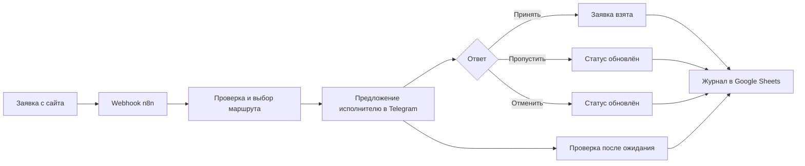

# Система распределения заявок для handyman-команды

Автоматизация для бизнеса по ремонту и мелким работам в Нью-Йорке. Заявка приходит с сайта, а исполнитель получает её в Telegram и отвечает кнопкой. n8n связывает эти действия с журналом в Google Sheets: кто получил предложение, что ответил и какой сейчас статус у заявки.

Я собрал рабочую версию для клиента на n8n. В исходном экспорте 64 узла, в том числе 24 Telegram и 21 Google Sheets. Оплата за эту работу составила 35 000 рублей.

## Как работает заявка

В Telegram исполнители отмечают доступность, получают предложения и отвечают на них. Для ответов и статусов есть отдельные ветки. Запись в таблицы связана с этими ветками, поэтому можно посмотреть историю обработки заявки.

Я также пробовал расширить систему очередью исполнителей: выбрать первого, предложить ему заявку и после ожидания перейти к следующему. У этой версии 107 узлов. Она осталась прототипом и в исходном экспорте выключена.

## Что пришлось продумать

Заявки приходят через webhook, а ответы исполнителей через Telegram Trigger. Между этими событиями нужно сохранять состояние в таблицах и разбирать разные нажатия кнопок. В рабочей версии есть ветка проверки через 10 минут, чтобы вернуться к предложению после ожидания.

В прототипе очереди я отдельно разбирал, как хранить место исполнителя и передавать предложение следующему человеку. Эта схема есть в репозитории, но я не проверял её как готовую систему для клиента.

## Что посмотреть

- [Схема рабочего workflow](workflow/architecture.json). Это очищенная копия структуры из n8n: узлы, их расположение и связи. Настройки узлов удалены, запускать её нельзя.
- [Схема прототипа очереди](workflow/queue-prototype-architecture.json). Такой же очищенный граф для второй версии. Он показывает, что было спроектировано, но не подтверждает работу очереди на реальных заявках.
- [Разбор маршрутов](docs/flow.md). Какие входы, ответы и изменения статуса есть в рабочей версии, и где начинается прототип очереди.
- [Пример заявки](examples/lead.json). Названия полей соответствуют входящему `body` в webhook. Значения вымышленные.

Публичная схема не содержит токены, идентификаторы чатов и таблиц, webhook-пути, сообщения клиентов или данные тестовых запусков. Поэтому она показывает устройство системы, но не служит готовым шаблоном для чужого аккаунта.

## Стек

n8n, Telegram Bot API, Google Sheets, webhook, JavaScript в Code nodes.
